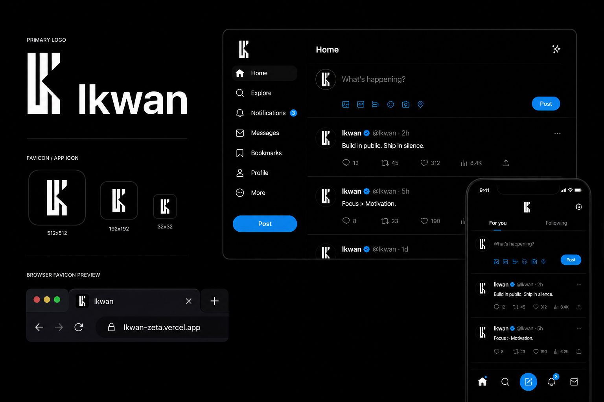

<div align="center">
    
</div>

<br/>

<div align="center">


</div>

# Lkwan — Frontend UI

A modern, real-time social media frontend built with React.

---

## What is Lkwan?

Lkwan is a full-featured social media UI where users can share posts, follow people, send direct messages, and stay connected with real-time updates — all without page refreshes. This repository contains only the frontend source code.

---

## Brand Identity & Interface Preview



---

## Key Features

- **Post Feed** — Share text and images. "For You" and "Following" feeds with infinite scroll.
- **Real-time Interactions** — Likes, comments, bookmarks, and follows update instantly via WebSocket.
- **Direct Messaging** — Private one-on-one chats with read receipts and image sharing.
- **Follow System** — Follow/unfollow users to curate your feed.
- **Verification Badges** — Dual-type verification: Standard (blue) and Artist (custom icon) badges.
- **Admin Panel** — Manage categories and grant/revoke artist verification.
- **Search** — Search posts by content, hashtags (`#tag`), and users (`@username`).
- **Media Upload** — Client-side image compression before upload.
- **Responsive Design** — Tailored layouts for mobile, tablet, and desktop.
- **Dark Theme** — Dark UI optimized for OLED screens.
- **PWA** — Installable on phone/desktop with offline support.

---

## Verification Badges

Lkwan supports two types of verification badges displayed next to usernames:

### Standard Badge (`verification.png`)
- Blue checkmark icon.
- Assigned to notable accounts.
- Configured via the `VERIFIED_NAMES` Set in `src/lib/verified.js`.

### Artist Badge (`artistVerification.png`)
- Custom mov music- themed icon.
- Assigned to artist/musician accounts.
- Configured via the `ARTIST_NAMES` Set in `src/lib/verified.js`.

### How it works

The `getVerificationType(user)` function in `src/lib/verified.js` determines which badge (if any) a user receives:

1. **Hardcoded Sets** — `VERIFIED_NAMES` and `ARTIST_NAMES` are declared as `Set`s at the top of the file. Usernames added here receive badges on every page load.
2. **localStorage** — The Admin Panel can Grant or Revoke artist verification at runtime via `addArtistName(username)` and `removeArtistName(username)`. These persist in the browser's `localStorage` under the key `lkwan_artist_names`.
3. **Merged resolution** — `getAllArtistNames()` returns a combined `Set` of the hardcoded `ARTIST_NAMES` plus any entries saved in `localStorage`. All badge checks use this merged set.

### Priority order
`artist` > `standard` > none. If a user matches both (e.g. in `ARTIST_NAMES` and `VERIFIED_NAMES`), the artist badge takes precedence.

### Rendering
The `VerificationBadge` component (`src/components/VerificationBadge.jsx`) accepts a `user` object and a `size` prop (`sm` / `md` / `lg`). It renders an inline `` with no click action or tooltip — purely visual.

---

## Tech Stack

- **Framework:** React 18
- **Bundler:** Vite
- **Styling:** Tailwind CSS
- **Routing:** React Router v6
- **Icons:** Lucide React
- **Markdown:** react-markdown
- **Rich Text:** @dnd-kit (drag-and-drop), Emoji Mart (emoji picker)
- **PWA:** vite-plugin-pwa

---

## Getting Started

```bash
git clone <repo-url>
cd lkwan
npm install
npm run dev
```

The app requires a Supabase backend to function. Create a `src/supabaseClient.js` file with your project credentials:

```js
import { createClient } from '@supabase/supabase-js'

const supabaseUrl = import.meta.env.VITE_SUPABASE_URL
const supabaseKey = import.meta.env.VITE_SUPABASE_ANON_KEY

export const supabase = createClient(supabaseUrl, supabaseKey)
```

Then create a `.env` file:

```
VITE_SUPABASE_URL=https://your-project.supabase.co
VITE_SUPABASE_ANON_KEY=your-anon-key
VITE_VAPID_PUBLIC_KEY=your-vapid-public-key
```

### Build for production

```bash
npm run build
npm run preview
```

---

<div align="center">
  Built with ❤️ by <a href="https://github.com/zakariaelqannaa-dv">@zakariaelqannaa-dv</a>
</div>
